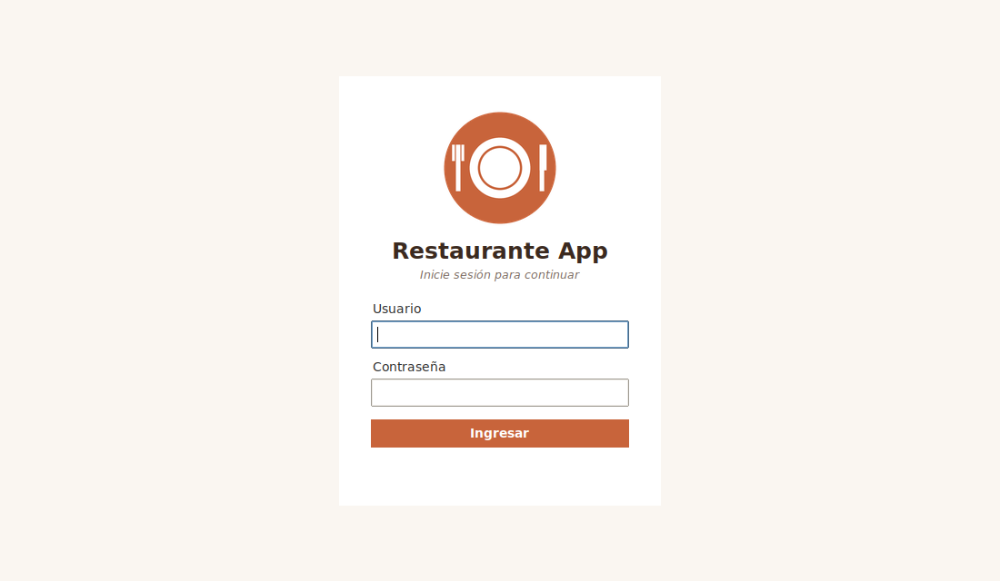
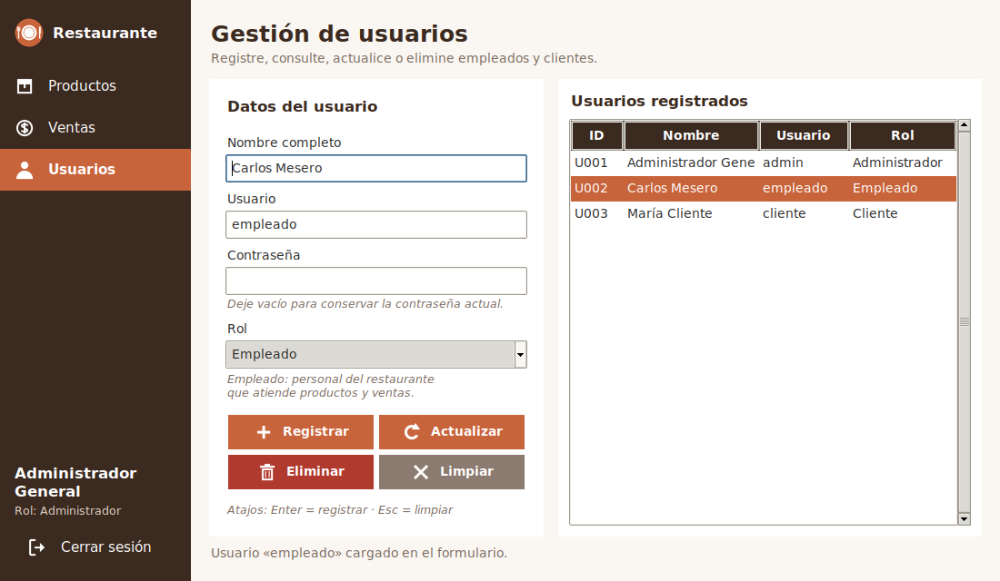
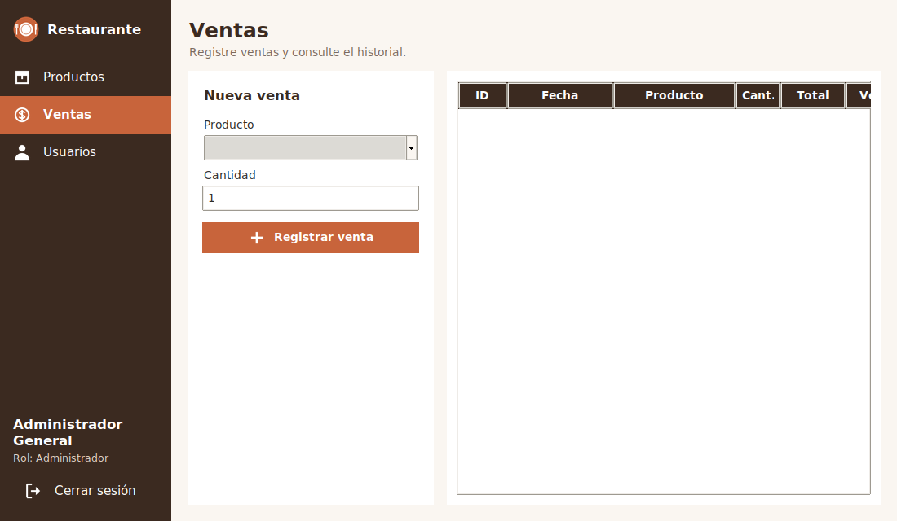

# Restaurante App — Semana 16: manejo de eventos en la gestión de usuarios

Aplicación de escritorio en **Python + Tkinter** para un restaurante. En la Semana 16 se evolucionó la sección **Usuarios**
(sin tocar la arquitectura ni las funciones previas) para aplicar **manejo de eventos** sobre una tabla `Treeview` y un formulario.

## Evolución respecto a la Semana 15
- El modelo `Usuario` incorpora el atributo **`rol`** (Administrador, Empleado, Cliente), persistido en `usuarios.json`.
- Nueva vista `ui/usuarios_view.py` con CRUD de usuarios (registrar, consultar, actualizar, eliminar).
- `RestauranteServicio` concentra validaciones, reglas de negocio y persistencia de usuarios.
- Se mantienen inicio de sesión, navegación, Productos y Ventas.
- Si `usuarios.json` viene de la semana anterior (sin roles), al cargar se asigna el rol Administrador a la cuenta `admin`
  y los demás usuarios quedan como Cliente.

## Estructura
```
repositorio/
├── README.md
└── restaurante_app/
    ├── datos/        usuarios.json, productos.json, ventas.json
    ├── modelos/      usuario.py, producto.py, venta.py
    ├── servicios/    archivo_servicio.py (lee/escribe JSON), restaurante_servicio.py (reglas y validaciones)
    ├── ui/           login_view.py, main_view.py, usuarios_view.py, estilos.py
    ├── assets/       logo e íconos PNG (generar_assets.py los recrea)
    ├── capturas/     capturas de pantalla de la aplicación en funcionamiento
    └── main.py
```

## Roles
| Rol | Acceso |
|---|---|
| Administrador | Productos, Ventas y **Usuarios** (gestiona Empleados y Clientes). |
| Empleado | Productos y Ventas. No ve la sección Usuarios. |
| Cliente | Productos y Ventas. No ve la sección Usuarios. |

Las cuentas de Administrador se muestran en la tabla pero son de solo lectura desde esta pantalla, y la cuenta con la sesión
activa no puede eliminarse.

## Eventos implementados
| Interacción | Mecanismo | Callback | Resultado |
|---|---|---|---|
| Seleccionar una fila de la tabla | `bind("<<TreeviewSelect>>")` | `al_seleccionar_fila` | Obtiene el `id` de la fila, consulta al servicio y carga el usuario en el formulario (sin contraseña). |
| Presionar Enter en el formulario | `bind("<Return>")` | `al_presionar_enter` | Llama a `registrar()`, el mismo método del botón Registrar. |
| Presionar Esc | `bind("<Escape>")` | `al_presionar_escape` | Llama a `limpiar()`: vacía el formulario y deselecciona la fila. |
| Cambiar el rol en el Combobox | `bind("<<ComboboxSelected>>")` | `al_cambiar_rol` | Actualiza la descripción del rol y el mensaje de estado. |
| Botones Registrar / Actualizar / Eliminar / Limpiar | `command=` | `registrar`, `actualizar`, `eliminar`, `limpiar` | Ejecutan la operación correspondiente. |

### `bind()`, `command=` y callbacks
- **`command=`** se usa en botones: asocia directamente el clic con una acción.
- **`bind()`** se usa para eventos que un botón no cubre (teclas, selección de tabla, cambio de opción). El callback recibe el objeto `event`.
- Los callbacks **solo coordinan**: leen el formulario, llaman al servicio y actualizan la interfaz. No duplican lógica:
  `<Return>` y el botón Registrar comparten `registrar()`; `<Escape>` y el botón Limpiar comparten `limpiar()`.

Flujo: interacción del usuario → evento → `bind()` → callback → `RestauranteServicio` → `usuarios.json` → actualización del Treeview.

## Persistencia
Todos los cambios de usuarios se guardan en `datos/usuarios.json` mediante `RestauranteServicio` y `ArchivoServicio`.
La interfaz no lee ni escribe archivos JSON. Al reiniciar la aplicación los usuarios se recuperan desde ese archivo.
Las contraseñas se guardan en texto plano porque el cifrado no es parte de esta práctica.

## Capturas
| Inicio de sesión | Gestión de usuarios (fila seleccionada) | Ventas |
|---|---|---|
|  |  |  |

## Cómo ejecutar
Requiere Python 3.8+ con Tkinter (incluido en la instalación estándar de Python).
```
cd restaurante_app
python main.py
```
Cuentas de prueba: `admin / admin123` (Administrador), `empleado / emp123` (Empleado), `cliente / cli123` (Cliente).

## Pruebas realizadas
Se comprobó: inicio de sesión, navegación, Productos y Ventas; acceso a Usuarios solo para el Administrador; registrar, seleccionar,
actualizar y eliminar (con confirmación); Enter y Escape; Combobox de rol; bloqueo de eliminar la cuenta en sesión; rechazo de usuarios
duplicados; y recuperación de datos desde `usuarios.json` tras reiniciar.
